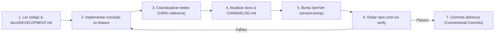

# Fluxo de Qualidade, Testes (100%) e Entrega Contínua

Este documento define a rotina oficial de engenharia do **Nexus**, aplicada tanto por desenvolvedores humanos quanto por agentes de IA (via [AGENTS.md](../AGENTS.md) e pela skill [nexus-delivery-flow](../.agents/skills/nexus-delivery-flow/SKILL.md)).

---

## 1. Ciclo Padrão de Toda Alteração



---

## 2. Arquitetura de Testes Automatizados

- **Runner & Cobertura:** [Vitest](https://vitest.dev/) + provedor `@vitest/coverage-v8`, configurado em [`vitest.config.ts`](../vitest.config.ts).
- **Diretório de testes:** `tests/`, espelhando a estrutura de `src/`:
  - `tests/cli/tui/NexusTuiApp.test.tsx` — testes de componente e regressão do cockpit TUI em Ink 6 (`useInput`, tabs, filtros, slash commands, execução ao vivo, timers e erro #321).
  - `tests/shared/cliArgs.test.ts` — parser completo de flags, subcomandos e roteamento TUI/CLI/GUI.
  - `tests/main/engine/envLoader.test.ts` — carregamento e parsing de perfis `.env.<perfil>` e `.env`.
  - `tests/main/adapters/nodeAdapter.test.ts` — detecção de projetos Node.js, lockfiles e `packageManager`.
  - `tests/helpers/renderInk.ts` — harness leve para testar componentes Ink 6 com `MockStdout` / `MockStdin` sem dependências extras.

### Política de Cobertura 100% (Coverage Ratchet)

Em [`vitest.config.ts`](../vitest.config.ts), os limites são estritos por arquivo (`perFile: true`):

- **Lines:** `100%`
- **Statements:** `100%`
- **Functions:** `100%`
- **Branches:** `100%`

> **Regra de expansão progressiva (Ratchet):** sempre que um novo módulo em `src/` for criado ou alterado, adicione seu caminho em `coverage.include` no `vitest.config.ts` e garanta 100% de cobertura antes do commit. Nunca reduza os thresholds.

---

## 3. Portão Único de Verificação (`verify`)

Antes de qualquer commit, execute:

```powershell
npm.cmd run verify
```

Esse comando executa em sequência:
1. `npm run typecheck` — checagem TypeScript em `main`, `preload`, `renderer`, `cli`, `shared` e `tests`.
2. `npm run test:coverage` — toda a suíte Vitest com validação obrigatória de 100% por arquivo.
3. `npm run build` — build completo do Electron + bundle `out/cli/index.js` + bundle `out/cli/tui.mjs`.

O mesmo portão é executado automaticamente no GitHub Actions:
- [`.github/workflows/ci.yml`](../.github/workflows/ci.yml) (push e PR em `main` no Ubuntu e Windows).
- [`.github/workflows/build.yml`](../.github/workflows/build.yml) (geração dos instaladores Windows/Linux e publicação de Releases).

---

## 4. Atualização do Binário Instalado Localmente (Windows)

Quando uma correção afeta o CLI/TUI (`out/cli/index.js` ou `out/cli/tui.mjs`), o comando global instalado pelo NSIS/MSI (em `%LOCALAPPDATA%\Programs\Nexus\resources\cli\`) só é atualizado ao gerar e instalar uma nova versão (ou ao testar localmente via `node bin/nexus.mjs` / `npm.cmd run tui` na raiz do repositório).
